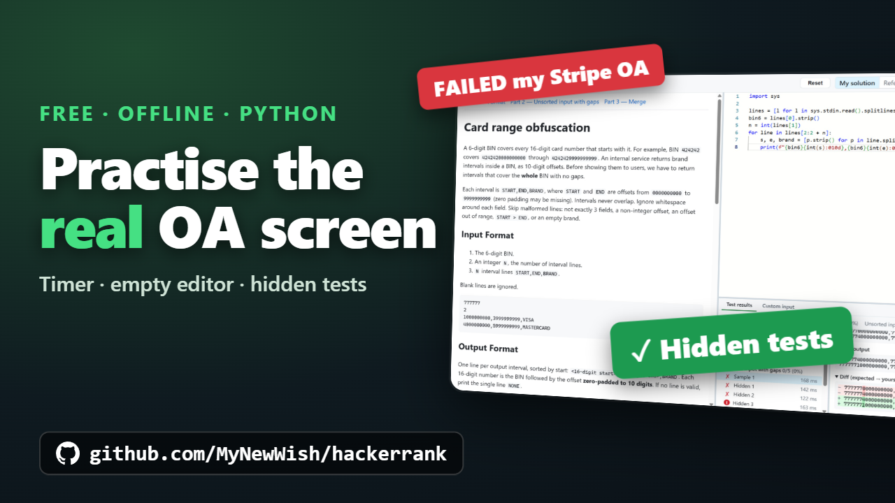

# Local HackerRank-Style Practice for Python

**Practise coding assessments the way they really feel, on your own machine, for free.**

[](https://youtu.be/mKtadcCcAHs)

▶️ [Watch the 2-minute demo on YouTube](https://youtu.be/mKtadcCcAHs)

A local app that works like HackerRank: a timer, an empty editor, sample tests and hidden tests.
You solve each problem in **Python**. Python is the only language supported for now.

You can practise any question you like. Open this folder in Claude Code, Codex or any other coding
agent and use the `add-question` skill. Paste the problem text or a URL and it builds a full practice
question with a spec, tests and a reference solution. The app comes with 14 Stripe-style questions
to start with.

## Why I built this

I failed my Stripe OA. When I looked back at what went wrong, three things stood out:

1. **It starts from an empty file.** No function stub, no scaffolding. You read stdin, parse it and
   print the exact output yourself. Most practice gives you a stub.
2. **I had no idea whether I could finish in an hour.** I had practised in my own IDE, but that is nothing
   like HackerRank: a timer running, sample tests, hidden tests, and output that has to match
   exactly. I'd never rehearsed under those conditions.
3. **Real practice is behind a paywall.** Nearly every site that offers timed, graded mock tests
   wants a subscription first.

So I built the practice environment I wish I'd had.

## What you get

- 🖥️ **A local HackerRank-like app for Python.** A timer, an empty editor with Python autocomplete, **Run** against the
  samples, **Submit** against hidden tests, and graded results for each part. Everything runs offline.
- 🤖 **Add any question with AI.** Paste problem text or a URL into Claude Code, Codex or any coding
  agent and the `add-question` skill turns it into a full question with a spec, tests and a reference solution.
- 📚 **14 Stripe-style starter questions.** Long, multi-part parsing and data-processing problems
  (payments, ledgers, routing, fraud rules, invoices), the kind candidates report getting.
- 🔍 **Reference solutions.** After a timed attempt, compare your code with a clean reference.

## Quick start

You need [Python](https://www.python.org/downloads/) 3.10+ and [Bun](https://bun.sh).

```bash
cd app
bun install
bun run dev
```

Pick a question on the Home screen, start the test, and the clock starts.

**Using a coding agent?** Open this folder in it and say *"set up and run the app"*. It will check
for Python and Bun and help you install anything that's missing. To grow the bank, say *"add this question: &lt;text or URL&gt;"*.

## Tips for the real thing

- Read the sample input and output twice. They are your real spec.
- Write the parser first, then one function per part. Part 3 shouldn't force a rewrite of Part 1.
- Get the sample passing, submit early, then fix edge cases: empty input, duplicates, ties,
  sort order and number formatting.
- Store money as integer cents or `Decimal`, never as float.
- A finished part is worth more than a perfect design you didn't finish.

## More

- [Study guide](docs/study-guide.md): what the screen looks like, a 7-day plan, a Python toolkit, sources.
- [Question format](docs/question-format.md): how a question folder works, if you want to write one by hand.

Good luck. Go get that offer. 🚀
